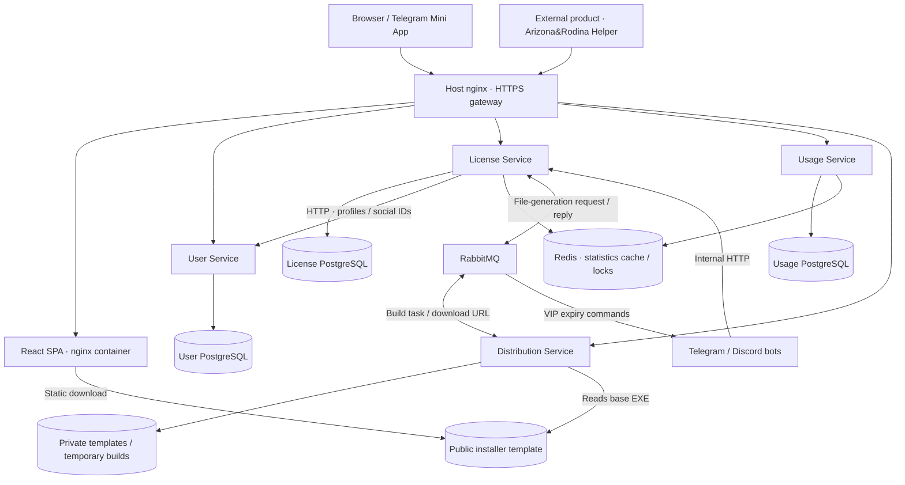
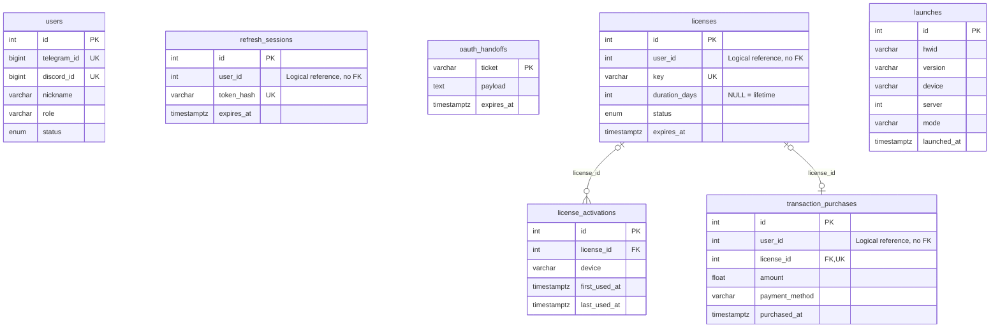

<h1 align="center">MTG MODS Platform</h1>

<p align="center">
  <strong>Micro-SaaS around a freemium digital product.</strong><br>
  Website, Python APIs and bots for Arizona&amp;Rodina Helper.<br>
  Free downloads · Public analytics · Subscriptions · Account management
</p>

<p align="center">
  <code>Python / FastAPI</code> &nbsp; <code>React / TypeScript</code> &nbsp; <code>PostgreSQL</code><br>
  <code>Redis</code> &nbsp; <code>RabbitMQ</code> &nbsp; <code>Docker Compose</code>
</p>

<p align="center">
  <a href="https://mtgmods.com">🌐 Website</a> &nbsp;·&nbsp;
  <a href="https://mtgmods.com/helper">🎮 Helper</a> &nbsp;·&nbsp;
  <a href="https://mtgmods.com/vip">📊 Sales analytics</a> &nbsp;·&nbsp;
  <a href="https://github.com/MTGMODS/arizona-helper">📂 Product source</a>
</p>

---

This is the **production platform around Arizona&Rodina Helper**. It serves free users and subscribers: discover the product, download it, view public statistics, compare plans and payment options, then manage purchased keys, personal devices and VIP downloads in an account.

> [!NOTE]
> **Platform infrastructure, not the game modification itself.**
> The Lua helper and Windows installer are developed in [arizona-helper](https://github.com/MTGMODS/arizona-helper). This repository contains the website, backend services and bot integrations that support them.

**Explore**<br>
[Features](#features) · [Background](#from-monolith-to-platform) · [Architecture](#architecture) · [Diagrams](#diagrams) · [Public statistics](#public-statistics)<br>
[Request flows](#request-flows) · [Docker setup](#run-with-docker) · [Operations](#operations) · [Tests](#tests-and-checks) · [Repository guide](#repository-guide)

<a id="related-projects"></a>

## 🧩 Related projects

| Project | Responsibility | Source |
| --- | --- | --- |
| **Arizona&Rodina Helper** | Lua modification for players and its Windows installer | [arizona-helper](https://github.com/MTGMODS/arizona-helper) |
| **MTG MODS Platform** | Python APIs, databases, licensing, delivery, analytics, website and bot integrations | This repository |
| **Mobile launcher patcher** | Prepares the mobile client to run the product | [arz_lua_launcher](https://github.com/MTGMODS/arz_lua_launcher) |

Usage and sales statistics are public. Personal subscriptions require sign-in; administration requires an admin role.

<a id="from-monolith-to-platform"></a>

## 🔄 From monolith to platform

The helper had an audience and paying users before this platform existed. Its supporting infrastructure developed in stages:

| When | Milestone |
| --- | --- |
| **2023** | Development of Arizona&Rodina Helper and growth of its user community. |
| **2024** | Monetization began through a VIP chat with file access, without a database. |
| **September 2025** | Development of the Python monolith: bots handled accounts, licenses and direct database access. |
| **Spring 2026** | A university microservices course prompted experiments with splitting the existing monolith into services. |
| **Summer 2026** | Continued backend redesign beyond the coursework, while the working monolith remained in production. |
| **Autumn 2026** | Launch of the React website, followed by incremental backend and UI improvements. |

The monolith worked well and served paying users. The redesign separated business logic from bot handlers, exposed it through APIs and moved account management to a website. Existing users, licenses and purchase history carried over into the new system.

The previous implementation is preserved in the [v0.0.0 release](https://github.com/MTGMODS/license-management-platform/releases/tag/v0.0.0). Its source is in the attached [legacy_monolith.zip](https://github.com/MTGMODS/license-management-platform/releases/download/v0.0.0/legacy_monolith.zip).

| Area | Earlier implementation | Current platform |
| --- | --- | --- |
| Application structure | Backend logic and database access inside the bots | Four Python services and a React website |
| Main customer interface | Bot interactions | Website and browser-based account dashboard |
| Telegram entry point | Bot interface | Mini App opens the same website inside Telegram |
| Bot responsibilities | Account and license management | Stars payments, VIP chats/roles, notifications and supporting commands |

The **website in a regular browser is the main interface**. The Mini App is another way to access it from Telegram.

---

<a id="features"></a>

## ✨ What the platform offers

### One website for free users and subscribers

| | What visitors can do |
| --- | --- |
| **🎮 Discover & download** | Read about the helper, download the free version, follow PC/mobile installation guides and explore usage statistics. |
| **💳 Compare & buy** | Check VIP features and prices, see public sales figures, choose a payment method and follow purchase instructions or payment details. |
| **🔑 Manage a subscription** | Sign in, activate a purchased key, view licenses and personal devices, use available device resets and download the personalized paid version. |

The product pages, free download instructions, payment information and public analytics are available **without an account**. The dashboard handles personal subscriptions after sign-in.

### Behind the website

| Area | What it does |
| --- | --- |
| **Accounts** | Telegram and Discord sign-in, linked social accounts, profiles, roles, JWT access tokens, refresh sessions, logout and Mini App sign-in |
| **Licensing** | Key generation and activation, subscription expiry, legacy lifetime licenses, device binding, per-plan device limits and reset quotas, game-client license checks |
| **Downloads** | Public free-download links and a static Windows installer; personalized VIP Lua files and installers with temporary links and cleanup |
| **Usage analytics** | Launch counts, unique device identifiers, free/VIP usage, PC/mobile split, versions, servers, factions and activity over time |
| **Sales analytics** | Completed paid purchases, revenue, payment methods, tariffs, first/repeat purchases, buyer retention and transitions between subscription plans |
| **Web application** | Product and download pages, public analytics, customer dashboard, administration, responsive layouts and Russian/Ukrainian/English translations |
| **Bots** | Telegram Stars checkout, VIP-chat admission/removal, Discord VIP roles and expiry notifications |

Telegram Stars payments are handled in the bot. The website also links to external marketplaces and gives instructions for manual payments.

---

<a id="architecture"></a>

## 🏗️ Architecture

The backend has **four Python/FastAPI services**. User, License and Usage each have their own PostgreSQL database. Distribution works with files in a mounted directory.

<a id="diagrams"></a>

### Diagrams

| File | Contents |
| --- | --- |
| [**architecture.md**](docs/architecture.md) | Current C4 Levels 1–3 in Mermaid, source references and implementation boundaries |
| [**architecture-context.mmd**](docs/architecture-context.mmd) | System context: people, existing product and external integrations |
| [**architecture-c4.mmd**](docs/architecture-c4.mmd) | Container view: gateway, web, four services, bots, databases, Redis, RabbitMQ and files |
| [**architecture-license-components.mmd**](docs/architecture-license-components.mmd) | Actual License Service components and concrete dependencies |
| [**er-model.dbml**](docs/er-model.dbml) | Database model: all tables, columns, indexes and foreign keys across the three service databases |

The overview below uses GitHub's Mermaid renderer. The [detailed architecture](docs/architecture.md) includes all three levels and editable Mermaid sources.



- **HTTP** handles browser/game-client requests and service-to-service lookups.
- **RabbitMQ** carries personalized-build requests and replies, plus bot commands.
- **Redis** caches statistics and coordinates refreshes between processes. Accounts, licenses and purchases stay in PostgreSQL.
- **Host nginx** terminates HTTPS and routes public traffic. It runs outside Compose; its configuration is in `gateway/`.
- The **web container's nginx** serves the compiled SPA and the public Windows installer.

<details>
<summary>🗃️ <strong>Database overview</strong> — expand tables and foreign keys</summary>

User Service stores users, refresh sessions and OAuth handoffs. License Service stores licenses, device activations and purchases. Usage Service stores launches. The full [DBML model](docs/er-model.dbml) includes every column and index.



Only real database foreign keys are drawn. User IDs in licenses, purchases and refresh sessions are logical references; the ORM does not define foreign keys for them. The prefixes in the DBML file group separate databases, not schemas in one database.

</details>

### Services

| Component | Location | What it handles |
| --- | --- | --- |
| **User Service** | [`services/user`](services/user/) | Users, social identities, refresh sessions and short-lived OAuth handoffs |
| **License Service** | [`services/license`](services/license/) | Licenses, purchases, device activations, tariffs and expiry processing |
| **Usage Service** | [`services/usage`](services/usage/) | Launch records and public usage aggregates |
| **Distribution Service** | [`services/distribution`](services/distribution/) | Personalized file generation and temporary Lua/EXE delivery |
| **Web** | [`web`](web/) | React client for public pages, accounts and administration |
| **Telegram / Discord** | [`bots`](bots/) | Stars payments, VIP chats, roles and messages through the license API |
| **Gateway** | [`gateway`](gateway/) | Host nginx configuration, public routing and request limits |

Each Python service keeps routes in `app/api`, business logic in `app/application`, schemas in `app/domain` and database/messaging code in `app/infrastructure`. Configuration and shared helpers live in `app/shared`.

### Technology stack

| Layer | Technologies |
| --- | --- |
| Backend | Python 3.12, FastAPI, Pydantic, async SQLAlchemy, asyncpg, HTTPX |
| Persistent data | PostgreSQL 16 in production; SQLite in debug mode and isolated tests |
| Shared cache | Redis 7.4, `redis.asyncio`, Lua scripts that check lock ownership before writing or releasing |
| Messaging | RabbitMQ 3.13, aio-pika |
| Frontend | TypeScript, React 19, Vite, Tailwind CSS, TanStack Query, Zustand, Recharts, i18next |
| Runtime | Docker Compose, nginx; Node.js 22 for the web image build |
| Verification | pytest, fakeredis, Vitest, Testing Library, TypeScript checks and Oxlint |

---

<a id="request-flows"></a>

## 🔀 Request flows

### Browse and download the free version

1. A visitor opens the public product page, installation guides or statistics without signing in.
2. The web app reads usage and sales figures from the public APIs. Product descriptions and installation instructions are part of the frontend.
3. Download links lead to the appropriate product files or releases. The free Windows installer is served directly by the web container's nginx.

Subscription features, prices, available payment methods and payment details are also public. Buying a key and managing it in the dashboard are separate steps.

### Sign in and manage a subscription

1. A user signs in through Telegram or Discord, or opens the Telegram Mini App.
2. User Service finds or creates the account and issues access/refresh tokens. It stores refresh-token hashes and short-lived OAuth handoffs in its database.
3. The dashboard uses the access token to request license information, activate a purchased key, reset a personal device or request a download.
4. License Service checks ownership and subscription rules in its database; profile/social information comes from User Service over internal HTTP.

The plan catalog lives in [`services/license/app/shared/tariffs.json`](services/license/app/shared/tariffs.json). It supplies website prices, Stars amounts and device/reset limits. Each License process caches it after the first read. Rebuild and recreate License Service after changing the file in this checkout.

### Generate and deliver the paid product

1. License Service verifies that the account has an active license.
2. It sends a file-generation request to RabbitMQ with a correlation ID and a reply queue.
3. Distribution generates the personalized Lua file and replies with its temporary download URL.
4. On Windows, the user can choose the Lua file or an installer stamped with that same Lua URL.
5. The API cleans up files after sending them; a scheduled worker removes abandoned builds. See [File-delivery lifecycle](#file-delivery-lifecycle).

The HTTP request waits up to **30 seconds** for the RabbitMQ reply with the download URL.

### Expire community access

The expiry worker checks subscriptions every **60 seconds**, commits status changes, resolves linked social IDs and publishes Telegram/Discord commands. The bots perform the corresponding chat/role actions.

---

<a id="public-statistics"></a>

## 📊 Public statistics

Usage and sales figures are open to everyone. The maintainer uses these same pages rather than a separate private analytics dashboard.

**The sales history spans the monolith and the current platform.** These totals describe purchases of the helper, not revenue created solely by the new website or microservices. Seven-day subscriptions were introduced with the rebuild; other plans already existed before it.

| Page | Scope | Public API |
| --- | --- | --- |
| [`/helper`](https://mtgmods.com/helper) | Usage, platforms, versions, servers, factions and activity | [`/v1/usage/stats/public`](https://api.mtgmods.com/v1/usage/stats/public) |
| [`/vip`](https://mtgmods.com/vip) | Paid subscriptions, revenue and buyer analytics | [`/v1/license/stats/public`](https://api.mtgmods.com/v1/license/stats/public) |
| [`/vip/legacy`](https://mtgmods.com/vip/legacy) | Legacy lifetime-license totals, payment/price breakdowns and activation counts | [`/v1/license/stats/old`](https://api.mtgmods.com/v1/license/stats/old) |

> [!NOTE]
> **Open figures, private account data.** Usage “users” are distinct device identifiers (HWIDs), not verified individual people. Public sales rows omit buyer identities, license keys and device identifiers.

Time-limited subscriptions and lifetime licenses are calculated separately. Legacy totals describe records still present in the database, not a complete history of deleted licenses.

### Cache behavior

Statistics use **stale-while-revalidate**: a cached result is fresh for **5 minutes** and remains available for up to **24 hours**. Once it becomes stale, a request returns the existing result immediately and, if it acquires the Redis lock, starts a background refresh. Refreshes are triggered by requests, not by a timer.

`updated_at` reports when the statistics were calculated. A cold cache can take longer to populate, so the page may initially report that statistics are unavailable.

<details>
<summary>⚙️ <strong>Cache details</strong> — keys, timeouts and failure handling</summary>

| Dataset | Redis key | Generation timeout | Lock timeout |
| --- | --- | --- | --- |
| Subscription sales | `mtgmods:license:public_stats:v2` | 90 seconds | 120 seconds |
| Legacy lifetime sales | `mtgmods:license:old_stats:v3` | 90 seconds | 120 seconds |
| Usage | `mtgmods:usage:public_stats:v2` | 300 seconds | 330 seconds |

The lock coordinates refreshes across processes. Redis scripts check ownership before publishing a result or releasing the lock. Background refreshes use their own database sessions.

On a cold cache, one request computes the result. Other requests wait up to **4 seconds**, then return **503** with `Retry-After: 2` if it is not ready. The browser uses a **2-second first attempt and one immediate 1-second retry**, so a cold dataset can initially appear unavailable while generation continues.

Redis's internal `{data, fresh_until}` wrapper is not exposed by the APIs. If Redis fails, a result already read from the cache can still be returned; otherwise the service computes directly from the database. This fallback can increase database load. Compose disables Redis persistence because the cached results can be rebuilt.

</details>

---

<a id="run-with-docker"></a>

## 🐳 Run with Docker

Run the application with **Docker Compose**. You need Docker with Linux containers and Compose v2; Python and Node.js run inside the containers.

### 1. Clone and configure

```sh
git clone https://github.com/MTGMODS/license-management-platform.git
cd license-management-platform
```

On a fresh clone, copy the examples below and edit the resulting `.env` files. Create all six files even when starting only the core APIs: Compose reads the configuration for the whole project.

<details>
<summary><strong>Linux / macOS</strong> — copy environment templates</summary>

```sh
cp services/user/.env.example services/user/.env
cp services/license/.env.example services/license/.env
cp services/usage/.env.example services/usage/.env
cp services/distribution/.env.example services/distribution/.env
cp bots/telegram/.env.example bots/telegram/.env
cp bots/discord/.env.example bots/discord/.env
```

</details>

<details>
<summary><strong>Windows PowerShell</strong> — copy environment templates</summary>

```powershell
Copy-Item services/user/.env.example services/user/.env
Copy-Item services/license/.env.example services/license/.env
Copy-Item services/usage/.env.example services/usage/.env
Copy-Item services/distribution/.env.example services/distribution/.env
Copy-Item bots/telegram/.env.example bots/telegram/.env
Copy-Item bots/discord/.env.example bots/discord/.env
```

</details>

Examples contain placeholders, not production credentials. Configure these values consistently:

| Setting | Where it must agree |
| --- | --- |
| `JWT_SECRET` | User and License services |
| `INTERNAL_SECRET_TOKEN` | User and License services |
| `BOT_SECRET_TOKEN` | License Service and both bots |
| PostgreSQL credentials | Each service's database URLs and its `POSTGRES_USER` / `POSTGRES_PASSWORD` / `POSTGRES_DB` |
| RabbitMQ credentials | Broker settings in License `.env` and every `RABBITMQ_URL` in License, Distribution and bots |
| OAuth configuration | Provider application settings, callback URLs and User Service's `FRONTEND_URL` |
| Public download base | Distribution's `DOWNLOAD_BASE_URL`, reachable from the browser/installer |

Keep `DEBUG_MODE=False` to use PostgreSQL. Internal URLs use Compose names such as `user-service`, `license-service`, `rabbitmq` and `redis`; browsers need public or host-accessible URLs.

### 2. Start the core APIs

This starts User, License and Usage with their databases, Redis and RabbitMQ, without the bots or private file-generation workflow:

```sh
docker compose config --quiet
docker compose up -d --build user-service license-service usage-service
docker compose ps
```

Services create missing tables on startup. Existing tables are not automatically migrated when ORM models change.

| Component | Local address | API explorer |
| --- | --- | --- |
| User | [localhost:8001/health](http://localhost:8001/health) | [localhost:8001/docs](http://localhost:8001/docs) |
| License | [localhost:8002/health](http://localhost:8002/health) | [localhost:8002/docs](http://localhost:8002/docs) |
| Usage | [localhost:8003/health](http://localhost:8003/health) | [localhost:8003/docs](http://localhost:8003/docs) |
| Distribution, when started | [localhost:8005/health](http://localhost:8005/health) | [localhost:8005/docs](http://localhost:8005/docs) |
| Web, when started | [localhost:8080](http://localhost:8080) | — |
| RabbitMQ management | [localhost:15672](http://localhost:15672) | Configured broker credentials |

PostgreSQL and Redis have no published host ports. PostgreSQL data lives in three named volumes; the fixed Compose project name `mtgmods_backend` also determines their names.

### 3. Connect the website to the API

> [!IMPORTANT]
> The compiled web image defaults to `https://api.mtgmods.com`.
> **Starting it locally does not automatically connect it to your local APIs.** Set your own gateway address before building.

For an independent deployment, create a root `.env` containing your gateway address before building:

```dotenv
VITE_API_URL=https://api.example.com
```

```sh
docker compose up -d --build web
```

`VITE_API_URL` is embedded at **build time**; restarting a container does not change it. The browser uses one gateway with `/v1/users`, `/v1/license`, `/v1/usage` and `/v1/files` prefixes. A single service's `:8001` port cannot replace that gateway.

Direct service routes include an additional `/api` prefix: for example, `http://localhost:8002/api/v1/license/stats/public` corresponds to `https://api.mtgmods.com/v1/license/stats/public` through the production gateway.

The checked-in [`gateway/`](gateway/) configuration is the production host-nginx setup for `mtgmods.com` and `api.mtgmods.com`, not a local gateway container. Adapt domains, certificates and upstreams for your deployment, together with backend CORS allowlists, `FRONTEND_URL` and OAuth callback registrations. Production-mode OAuth uses secure cookies and expects HTTPS.

### 4. Enable file delivery and bots

Tests run without private product assets or production credentials. To generate real VIP files and enable the bots, provide the following:

| File / setting | Location |
| --- | --- |
| VIP Lua templates | `services/distribution/app/builds/vip/` |
| Obfuscator tooling | `services/distribution/app/tools/` |
| Public Windows installer template | `services/distribution/app/builds/installer/Arizona&Rodina Helper.exe` |
| Telegram / Discord credentials and chat/role IDs | The corresponding bot `.env` files |

Private build assets and local `.env` files are excluded from Git. Place the templates and tools before building Distribution. Download the public installer template from the [product's Windows installer release](https://github.com/MTGMODS/arizona-helper/releases/download/windows-installer/Arizona.Rodina.Helper.exe) and save it under the exact filename above. Without that template, free installer downloads and VIP installer generation are unavailable.

Once credentials, assets and public routing are configured:

```sh
docker compose up -d --build
docker compose ps
```

Use separate bot credentials for development; only one polling process should run with a given Telegram bot token.

<a id="file-delivery-lifecycle"></a>

## 📦 File-delivery lifecycle

### Free installer · static download

[`/helper/download/installer`](https://mtgmods.com/helper/download/installer) is served by the web container's nginx. Compose mounts only the public `installer/` subdirectory read-only into web. Free installer downloads bypass Python, RabbitMQ and personalized-build processing. The old API installer route redirects to this URL.

### VIP Lua · personalized file

`/v1/files/downloads/vip/<token>` serves a temporary personalized file. Response cleanup removes the Lua file, associated EXE files and installer-use marker.

### VIP installer · personalized download URL

`/v1/files/downloads/vip/<token>.exe` stamps a copy of the base installer with the Lua URL. An atomic `.exe.used` marker prevents repeated installer generation for that token. Response cleanup removes the generated EXE, while the Lua file remains available for the installer to fetch. The base installer is never overwritten.

### Cleanup

The cleanup worker runs **hourly** and removes top-level generated Lua/EXE/temp/marker files older than **one hour**. It leaves template subdirectories untouched. This is not an exact one-hour expiry: a file becomes eligible after one hour and is removed on a later sweep. A personalized installer must run while its Lua link is still available.

---

<a id="operations"></a>

## 🛠️ Operations

Run from the repository root:

```sh
# Container state and recent API logs
docker compose ps
docker compose logs --since=10m --tail=200 user-service license-service usage-service distribution-service

# Redis availability and statistics keys
docker compose exec -T redis redis-cli ping
docker compose exec -T redis redis-cli --scan --pattern 'mtgmods:*:*stats:v*'

# Queue backlog and active consumers
docker compose exec -T rabbitmq rabbitmqctl list_queues name messages_ready messages_unacknowledged consumers

# Rebuild a changed service without restarting its dependencies
docker compose up -d --build --no-deps license-service

# Stop containers while keeping named database volumes
docker compose down
```

Container health checks confirm basic availability, not a complete payment or download flow. OAuth, bot permissions, queue delivery and VIP generation need integration checks. Reload host nginx separately after changing its configuration.

<a id="tests-and-checks"></a>

## 🧪 Tests and checks

Tests cover business rules and error handling without production credentials. Python tests use temporary SQLite databases, files, fakeredis and mocked external services. Web tests cover API responses, sign-in/session handling, protected routes, checkout, translations and analytics controls.

Run in disposable containers from the repository root. The checkout is read-only; web dependencies use a separate temporary `node_modules` volume, avoiding host dependencies. The commands work in a POSIX shell or PowerShell:

```sh
# Four Python services and both bots
docker run --rm --mount "type=bind,source=.,target=/workspace,readonly" --workdir /workspace --env PYTHONDONTWRITEBYTECODE=1 python:3.12-slim sh -c "pip install --no-cache-dir -r tests/requirements.txt && python -m pytest tests -q -p no:cacheprovider"

# Web type checks, component tests and lint
docker run --rm --mount "type=bind,source=.,target=/workspace,readonly" --mount type=volume,target=/workspace/web/node_modules --workdir /workspace/web node:22-alpine sh -c "npm ci && npm run typecheck && npm test && npm run lint"
```

| Suite | Examples of covered behavior |
| --- | --- |
| User | Social linking, JWT validation, refresh rotation/replay/logout, one-use OAuth handoffs, Mini App signatures and admin access |
| License | Activation/replacement, expiry/ban/inactive states, device limits/resets, purchase statistics, ownership and download authorization |
| Usage | Launch validation, distinct-HWID aggregation, time windows, empty datasets and database writes |
| Distribution and bots | File delivery/cleanup, installer behavior, payment validation, queue dispatch, chat admission and role actions |
| Shared statistics cache | Fresh/stale reads, cold starts, concurrent refresh, lock ownership, failed refresh, timeouts and Redis outages |
| Web | Errors/timeouts, auth state, protected routes, purchase flows, sales filters/pagination, formatting and locale rules |

The suites do not cover every production integration. PostgreSQL concurrency, live RabbitMQ delivery, Telegram/Discord APIs, the private obfuscator and real-browser behavior need separate checks. See [`tests/README.md`](tests/README.md) for details.

---

<a id="repository-guide"></a>

## 🗂️ Repository guide

```text
├── services/
│   ├── user/              # Accounts, OAuth and sessions
│   ├── license/           # Licenses, purchases, devices and tariffs
│   ├── usage/             # Launch logging and statistics
│   └── distribution/      # Personal VIP files and installers
├── bots/
│   ├── telegram/          # Stars payments, VIP chat and Mini App entry
│   └── discord/           # VIP roles and messages
├── web/                   # React website, UI tests and web nginx
├── gateway/               # Host nginx configuration
├── tests/                 # Python tests
├── docs/
│   ├── architecture.md    # Current C4 Levels 1–3 and source references
│   ├── architecture-*.mmd # Editable context/container/component diagrams
│   └── er-model.dbml      # Tables, indexes and foreign keys
└── docker-compose.yml     # Services, databases, Redis and RabbitMQ
```

<a id="author-and-development-approach"></a>

## 👤 Development approach

This is a solo-maintained project. **Bohdan / MTGMODS** designs the backend, defines product behavior and operates the production system. AI tools were used differently across the codebase:

| Area | Author's work and use of AI |
| --- | --- |
| **Architecture** | The author analysed the old monolith, designed the services, chose where data belongs and planned deployment. |
| **Python backend and bots** | Written by the author, then refined with help from Cursor and Codex. He reviewed AI changes and is responsible for the code. |
| **React frontend** | Fully generated through prompts in Cursor and Codex. The author set requirements, directed UI changes and checked the result in the browser; he did not write the frontend source by hand. |

**Cursor** and **ChatGPT / Codex by OpenAI** also assist with tests, refactoring and documentation, including this README.

Source-code contributions are recorded in the [GitHub contributors graph](https://github.com/MTGMODS/license-management-platform/graphs/contributors).

---

<a id="license"></a>

## 📄 License

Source code in this repository is available under the [PolyForm Noncommercial License 1.0.0](LICENSE), which permits noncommercial use under its terms. See `LICENSE` for the full conditions.

The external product has its own repository and license. Private deployment assets are not included in this checkout.
