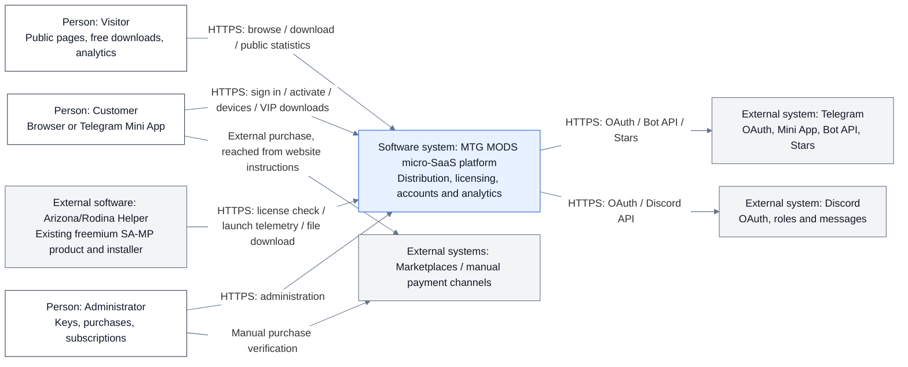

# Current architecture

These C4-style views describe the implementation in this repository, checked against source on **2026-10-31**. They cover the platform around the existing Arizona&Rodina Helper, a freemium software product for SA-MP players. Product development is outside this repository.

The diagrams use Mermaid flowcharts with explicit system, container and component boundaries. A container is a running application or data service; file stores are labeled separately. Deployment details such as host ports supplement the container view.

## Level 1 — System context

[Mermaid source](architecture-context.mmd)

Visitors use public pages, free downloads and analytics. Customers sign in through Telegram or Discord to manage subscriptions, devices and VIP downloads. Administrators manage licenses and purchases. The game client sends license checks and launch telemetry; the product's installer also fetches personalized files.

Telegram Stars checkout runs in the Telegram bot. Other payment channels are external marketplaces or manual payment instructions. An external purchase is verified manually before a key is issued; there is no marketplace payment API or webhook in these views. The Telegram Mini App opens the same website used in a regular browser.

## Level 2 — Containers

[Mermaid source](architecture-c4.mmd)

```mermaid
%%{init: {"theme":"base","themeVariables":{"fontFamily":"Arial, sans-serif","fontSize":"16px","lineColor":"#64748b","clusterBkg":"#f8fafc","clusterBorder":"#cbd5e1","edgeLabelBackground":"#ffffff"},"flowchart":{"htmlLabels":true,"curve":"linear","nodeSpacing":35,"rankSpacing":65,"wrappingWidth":220}}}%%
flowchart TB
  %% C4 Level 2 with deployment annotations. Host nginx is outside Compose.
  Browser["Client: Browser / Telegram Mini App<br/>Same React application"]
  Helper["External software: Arizona/Rodina Helper<br/>Free / VIP game client and installer"]
  Telegram["External system: Telegram<br/>OAuth / Bot API / Stars"]
  Discord["External system: Discord<br/>OAuth / API"]
  Market["External systems: Marketplaces / manual payments"]

  subgraph MTG["Software system: MTG MODS micro-SaaS platform"]
    Nginx["Infrastructure: Host nginx<br/>HTTPS gateway / rate limits, outside Compose"]
    subgraph Compose["Docker Compose deployment"]
      Web["Container: Web nginx<br/>React SPA / public installer"]
      UserAPI["Container: User Service<br/>FastAPI: OAuth / JWT / profiles / sessions"]
      LicenseAPI["Container: License Service<br/>FastAPI: licenses / devices / sales"]
      UsageAPI["Container: Usage Service<br/>FastAPI: launch telemetry / aggregates"]
      DistributionAPI["Container: Distribution Service<br/>FastAPI: VIP Lua / stamped EXE"]
      UserDB[("Container: User PostgreSQL<br/>Users / refresh sessions / OAuth handoffs")]
      LicenseDB[("Container: License PostgreSQL<br/>Licenses / devices / purchases")]
      UsageDB[("Container: Usage PostgreSQL<br/>Launch records")]
      Rabbit["Container: RabbitMQ<br/>Build request/reply / bot commands"]
      Redis[("Container: Redis<br/>Public statistics / refresh locks")]
      TgBot["Container: Telegram bot<br/>Stars checkout / VIP chat"]
      DsBot["Container: Discord bot<br/>VIP roles / messages"]
    end
    Installer[("File store: Public installer directory<br/>Read-only mount in Web")]
    Assets["Private assets: VIP template / obfuscator<br/>Used by Distribution only"]
    Builds[("File store: Mounted builds directory<br/>Temporary Lua / EXE / used markers")]
  end

  Browser -->|"HTTPS: website / API / downloads"| Nginx
  Helper -->|"HTTPS: check / launch / VIP file fetch"| Nginx
  Browser -->|"External purchase via website links / instructions"| Market
  Nginx -->|"HTTP :8080: SPA / free installer"| Web
  Nginx -->|"HTTP :8001: /v1/users to /api/v1/users"| UserAPI
  Nginx -->|"HTTP :8002: /v1/license to /api/v1/license"| LicenseAPI
  Nginx -->|"HTTP :8003: /v1/usage to /api/v1/usage"| UsageAPI
  Nginx -->|"HTTP :8005: /v1/files to /api/v1/files"| DistributionAPI
  UserAPI -->|"SQL / PostgreSQL TCP"| UserDB
  LicenseAPI -->|"SQL / PostgreSQL TCP"| LicenseDB
  UsageAPI -->|"SQL / PostgreSQL TCP"| UsageDB
  LicenseAPI -->|"RESP / TCP: sales statistics"| Redis
  UsageAPI -->|"RESP / TCP: usage statistics"| Redis
  LicenseAPI -->|"HTTP / JSON: profiles / social IDs, x-internal-token"| UserAPI
  LicenseAPI -->|"AMQP: build request, correlation_id / reply_to"| Rabbit
  Rabbit -->|"AMQP: file_generation_queue"| DistributionAPI
  DistributionAPI -->|"AMQP: download URL to reply queue"| Rabbit
  Rabbit -->|"AMQP: matching reply"| LicenseAPI
  LicenseAPI -->|"AMQP: mtgmods.bot.commands topic exchange"| Rabbit
  Rabbit -->|"AMQP: telegram.#"| TgBot
  Rabbit -->|"AMQP: discord.#"| DsBot
  TgBot -->|"HTTP / JSON: bot endpoints, x-bot-token"| LicenseAPI
  DsBot -->|"HTTP / JSON: bot endpoints, x-bot-token"| LicenseAPI
  UserAPI -->|"HTTPS: OAuth code exchange"| Telegram
  UserAPI -->|"HTTPS: OAuth / profile API"| Discord
  TgBot -->|"HTTPS: Bot API / Stars / chat access"| Telegram
  DsBot -->|"HTTPS: Discord API / roles / messages"| Discord
  Web -->|"Filesystem read: static free EXE"| Installer
  DistributionAPI -->|"Filesystem read: base EXE for stamping"| Installer
  DistributionAPI -->|"Local read / tool execution"| Assets
  DistributionAPI -->|"Filesystem read / write / unlink"| Builds

  classDef external fill:#f3f4f6,stroke:#6b7280,color:#111827
  classDef app fill:#e8f1ff,stroke:#2563eb,color:#111827
  classDef data fill:#ecfdf5,stroke:#059669,color:#111827
  class Browser,Helper,Telegram,Discord,Market external
  class Nginx,Web,UserAPI,LicenseAPI,UsageAPI,DistributionAPI,Rabbit,TgBot,DsBot app
  class UserDB,LicenseDB,UsageDB,Redis,Assets,Builds,Installer data
```

- **Host nginx** terminates HTTPS and proxies to the published Web/API ports. It belongs to the platform deployment but runs outside Docker Compose. The web container has a separate nginx serving the SPA and the public installer.
- **User, License and Usage** each own a PostgreSQL database. Cross-service user IDs are logical references, not cross-database foreign keys. License obtains user profiles and social IDs from User over internal HTTP.
- **Redis** holds rebuildable public statistics and refresh locks for License and Usage. Accounts, licenses and purchases remain in PostgreSQL.
- **RabbitMQ** carries VIP-build requests and correlated replies. License waits for the reply containing a download URL, so the browser's download request waits for this workflow. The same broker delivers expiry commands through the `mtgmods.bot.commands` topic exchange to `telegram.#` and `discord.#` consumers.
- **Distribution** generates personalized files and serves temporary downloads without a relational database. Only Distribution accesses private templates, the obfuscator and personalized builds. Web mounts only the public installer subdirectory read-only.

API prefixes at the public gateway omit the backend's `/api` segment: `/v1/license/...` becomes `/api/v1/license/...`, with equivalent mappings for User, Usage and Distribution. Ports in the diagram are published host ports; each FastAPI container listens on port 8000 internally.

## Level 3 — License Service components

[Mermaid source](architecture-license-components.mmd)

```mermaid
%%{init: {"theme":"base","themeVariables":{"fontFamily":"Arial, sans-serif","fontSize":"16px","lineColor":"#64748b","clusterBkg":"#f8fafc","clusterBorder":"#cbd5e1","edgeLabelBackground":"#ffffff"},"flowchart":{"htmlLabels":true,"curve":"linear","nodeSpacing":35,"rankSpacing":65,"wrappingWidth":220}}}%%
flowchart TB
  %% C4 Level 3: actual concrete dependencies in services/license/app.
  Caller["Other containers: Host gateway / bots"]
  UserAPI["Other container: User Service"]
  PG[("Other container: License PostgreSQL")]
  Redis[("Other container: Redis")]
  MQ["Other container: RabbitMQ"]
  subgraph License["Container boundary: License Service / Python FastAPI"]
    Routes["Component: REST routers<br/>client / user / admin / bot / stats"]
    DTO["Component: Pydantic DTOs<br/>domain/schemas.py"]
    Guards["Component: Route-specific guards<br/>JWT access / ADMIN / x-bot-token"]
    Service["Component: LicenseService<br/>Activation / validity / devices / purchases"]
    Stats["Component: LicenseStatsService<br/>Public / legacy sales aggregates"]
    Worker["Component: Expiry task<br/>Status updates / social lookup / commands"]
    Repo["Component: LicenseRepository / TransactionRepository<br/>Concrete SQLAlchemy repositories and ORM models"]
    Client["Component: UserServiceClient<br/>Concrete HTTPX client"]
    Messaging["Component: Messaging functions<br/>aio-pika RPC / topic publisher"]
    Cache["Component: PublicStatsCache<br/>Redis / loader callback / refresh lock"]
    DB["Component: Database session factory<br/>get_db / AsyncSessionLocal"]
    Bootstrap["Component: FastAPI app / lifespan<br/>Router registration / caches / expiry task"]
    Errors["Cross-cutting: Error handlers<br/>DomainException / RequestValidationError"]
  end
  Caller -->|"HTTP / JSON"| Routes
  Routes -->|"FastAPI input validation"| DTO
  Routes -->|"Depends on protected routes"| Guards
  Routes -->|"Depends: get_db session"| DB
  Routes -->|"Python: LicenseService(db) / methods"| Service
  Routes -->|"Python: LicenseStatsService(app.state cache)"| Stats
  Routes -->|"Python await: download RPC after license check"| Messaging
  Service -->|"Constructs concrete repositories with session"| Repo
  Service -->|"Constructs / calls concrete client"| Client
  Service -->|"AsyncSession: flush / commit / refresh"| DB
  Stats -->|"cache.get(loader, background_tasks)"| Cache
  Stats -->|"Loader: own AsyncSessionLocal"| DB
  Stats -->|"Loader: LicenseRepository(db) aggregate query"| Repo
  Worker -->|"Own AsyncSessionLocal / commit"| DB
  Worker -->|"Constructs / calls LicenseRepository"| Repo
  Worker -->|"Resolves linked social IDs"| Client
  Worker -->|"Python await: VIP expiry commands"| Messaging
  Repo -->|"Injected AsyncSession: SQLAlchemy statements"| DB
  DB -->|"asyncpg / SQL / PostgreSQL TCP"| PG
  Client -->|"HTTP / JSON: x-internal-token"| UserAPI
  Messaging -->|"AMQP / TCP: build request/reply and bot commands"| MQ
  Cache -->|"RESP / TCP: cached aggregates / locks"| Redis
  Bootstrap -->|"include_router"| Routes
  Bootstrap -->|"Constructs two app.state caches / closes on shutdown"| Cache
  Bootstrap -->|"asyncio task: start / cancel"| Worker
  Bootstrap -->|"Registers exception handlers"| Errors
  Routes -.->|"DomainException / validation exception dispatch"| Errors
  Service -.->|"Raises DomainException on business errors"| Errors
  classDef external fill:#f3f4f6,stroke:#6b7280,color:#111827
  classDef component fill:#e8f1ff,stroke:#2563eb,color:#111827
  classDef storage fill:#ecfdf5,stroke:#059669,color:#111827
  class Caller,UserAPI,MQ external
  class PG,Redis storage
  class Routes,DTO,Guards,Service,Stats,Worker,Repo,Client,Messaging,Cache,DB,Bootstrap,Errors component
```

The component view groups related Python functions and classes; each box is not a separate process. The API, caches and expiry task run inside the License application process.

1. **REST routers** validate Pydantic DTOs and use route-specific guards. Dashboard routes require access JWTs, admin routes additionally require the `ADMIN` role, and bot routes require `x-bot-token`. Public statistics, tariffs and the game-client license-check route do not use the dashboard JWT guard.
2. **LicenseService** receives an SQLAlchemy `AsyncSession`, creates concrete `LicenseRepository`, `TransactionRepository` and `UserServiceClient` objects, and performs business operations. The application layer directly uses infrastructure and ORM types. FastAPI injects sessions and guards; application-owned repository ports and a complete dependency-inversion composition root are not implemented.
3. **Download orchestration** is in `user_routes.request_download`: it checks the active license through `LicenseService`, then calls `publish_file_generation_event` directly. There is no separate injected Download use-case class.
4. **Sales statistics** use two caches created in FastAPI lifespan: current subscriptions and legacy lifetime licenses. `LicenseStatsService` supplies loader callbacks; each loader creates its own database session and queries `LicenseRepository`, including when a refresh runs after the HTTP response.
5. **Expiry processing** is an asyncio task started in lifespan. It opens its own session, updates expired licenses, commits, resolves social IDs through `UserServiceClient`, and publishes bot commands. It runs within the License container.
6. **Error handling** registers `DomainException` and `RequestValidationError` handlers. `HTTPException` uses FastAPI's standard handler; the client-check route also has its own catch/response branch. Diagnostics use Python logging in the cache and stdout messages in integrations/expiry processing. The diagram does not assert a universal sanitized error boundary or distributed tracing.

## Operational boundaries

The RabbitMQ RPC reply wait is limited to **30 seconds** after connection/channel/queue/publish setup. This is not an enforced 30-second end-to-end build deadline. A timeout does not itself cancel a build already accepted by Distribution.

Correlation IDs match replies; they do not provide request deduplication. A database commit followed by command publication is not atomic, and the implementation has no transactional outbox. Compose defines one instance of each service, broker and database; these diagrams do not assert replication, high availability or exactly-once delivery.

For cache timing, file cleanup and deployment instructions, see the [root README](../README.md#public-statistics), [file-delivery lifecycle](../README.md#file-delivery-lifecycle) and [Docker setup](../README.md#run-with-docker).

## Source references

- Runtime topology and mounts: [docker-compose.yml](../docker-compose.yml).
- Host routing: [API virtual host](../gateway/sites-available/api.mtgmods.com), [website virtual host](../gateway/sites-available/mtgmods.com); static installer: [web nginx](../web/nginx.conf).
- OAuth and Mini App authentication: [User auth routes](../services/user/app/api/auth_routes.py).
- License lifecycle wiring: [app/main.py](../services/license/app/main.py).
- Routes: [user/download](../services/license/app/api/user_routes.py), [client](../services/license/app/api/client_routes.py), [admin](../services/license/app/api/admin_routes.py), [bot](../services/license/app/api/bot_routes.py), [statistics](../services/license/app/api/stats_routes.py).
- Guards and DTOs: [JWT helpers](../services/license/app/application/jwt_utils.py), [schemas](../services/license/app/domain/schemas.py).
- Business logic and data access: [services](../services/license/app/application/service.py), [repositories and ORM models](../services/license/app/infrastructure/repository.py), [session factory](../services/license/app/shared/database.py).
- Integrations: [HTTP client](../services/license/app/infrastructure/external_clients.py), [messaging](../services/license/app/infrastructure/messaging.py), [statistics cache](../services/license/app/infrastructure/stats_cache.py), [expiry task](../services/license/app/application/worker.py), [error handlers](../services/license/app/shared/exceptions.py).
- Build consumer and reply: [Distribution messaging](../services/distribution/app/infrastructure/messaging.py); bot consumers: [Telegram](../bots/telegram/app/rabbitmq.py), [Discord](../bots/discord/app/rabbitmq.py).

The `.mmd` files are the editable diagram sources. Keep the embedded Mermaid blocks in this document synchronized with them.
